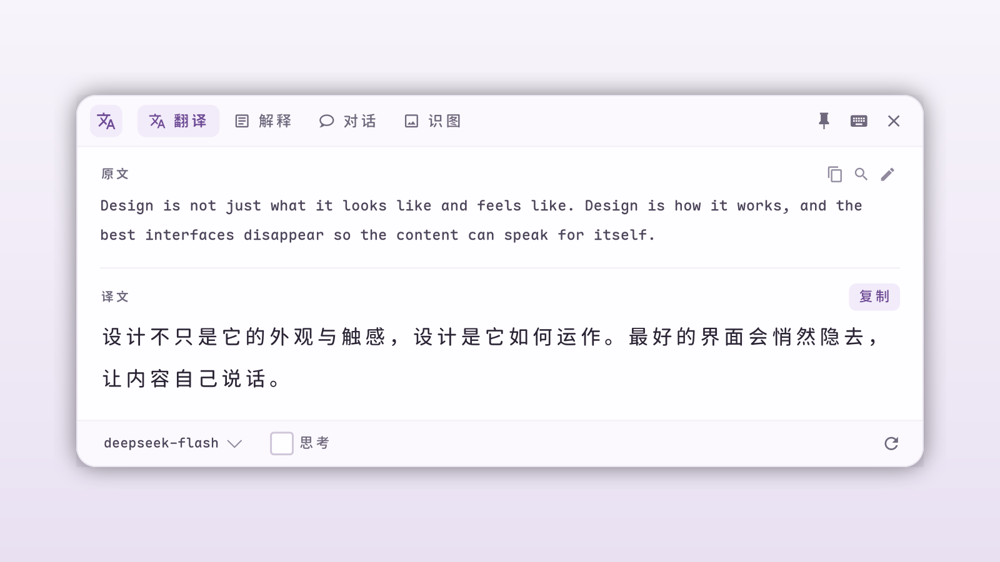

# Pop Translate

**English** | [中文](./README.md)

A lightweight, beautiful AI-powered word selection translation and explanation tool for Linux (native GTK4, Wayland/X11 support).

Select any text, press a global shortcut, and get instant translation, detailed explanation, or an interactive chat in a premium, hardware-accelerated macOS-style popup window.



## ✨ Features

- **🚀 GUI Initial Configuration** — No command-line setup required! If no API key is configured on first start, a beautiful GUI configuration wizard will guide you to set your API Key, API URL, and Model.
- **🎨 Content-First, Lightweight Interface** — A single compact header holds the brand, tabs, and window actions. The source stays quiet in small print (clamped to three lines), while the translation/explanation is the visual hero: larger type, more breathing room. Model, thinking, and regenerate controls move to a slim footer so they never crowd the result. A light palette, blue accent, and one consistent icon set tie the four tabs together.
- **🗂️ Powerful Tabbed Workflow**:
  - **Translate (翻译)** — Instant translation with smart bidirectional language detection (English ⇄ Chinese). Support for inline text editing to refine the source text.
  - **Explain (解释)** — A clear Markdown hierarchy for unfamiliar concepts, syntax, or words, with short and detailed modes.
  - **Chat (对话)** — A content-first transcript where assistant replies flow without heavy bubbles. The input, model, thinking, and context controls share one compact composer card; replies support copy, edit, and regenerate.
  - **Vision (识图)** — Capture a screen region and send the image straight to a vision LLM (e.g. `deepseek-flash`): transcribe and translate text in the image, explain errors/code, or describe charts. Analysis and follow-up questions share the same chat-bubble UI with full multi-turn conversation (the screenshot is re-sent to the model on every turn), message editing, regeneration, and one-click copy; switch between "smart analysis" and "detailed description" modes to re-analyze.
- **🧠 Collapsible Thinking Process Panel** — Streams and visualizes the reasoning process (e.g. DeepSeek-R1) in a native collapsible expander (`Gtk.Expander`) with a premium left border. Auto-collapses when generating finishes to keep the UI clean.
- **🧹 Reset to Pure Chat** — Clear Chat and all cached text/translation/explanation context with a single click of the "Clear Content (清空内容)" button to switch to pure dialog.
- **⚡ Keyboard-First Navigation** — Operates entirely mouse-free. Easy-to-remember shortcuts for tab switching, copying, editing, and toggling options. Supports smart `Esc` key interception (stops active stream generation instead of closing the window).
- **📭 Content-Driven Layout** — Short messages stay compact, while GTK's native text layout handles long replies, Markdown, and window resizing. Content scrolls independently of the footer settings and composer. Long source text clamps to three lines with an expand toggle. Screenshots appear in a compact attachment strip with a clickable preview, and active generation can be stopped from the composer.
- **🔒 Security & API Leak Protection** — Automatic redaction and sanitization of API keys, Bearer tokens, or generic `sk-` credentials in error messages or logs.
- **💾 Local SQLite Caching** — Identical selection queries hit a local SQLite cache instantly, avoiding duplicate API calls. Auto-clears entries older than 24 hours to stay lightweight.
- **🛸 Zero Idle Footprint** — Designed as a popup widget. Standard processes exit instantly upon closing, consuming zero background RAM.
- **🔄 Synchronized Thinking State** — Seamless sync of the "Thinking" state toggles across Translate, Explain, and Chat tabs.

---

## ⌨️ Global & Local Keyboard Shortcuts

Pop Translate is designed with keyboard-first users in mind. 

### Local Window Shortcuts (when window is active):
- `S` — Switch to **Translate (翻译)** Tab
- `W` — Switch to **Explain (解释)** Tab
- `C` — Switch to **Chat (对话)** Tab
- `V` — Switch to **Vision (识图)** Tab (start a capture directly from the empty tab)
- `E` — **Edit (编辑)** original text
- `R` — **Regenerate (重生成)** translation / explanation / chat message
- `Y` — **Copy (复制)** translated text (only in Translate tab)
- `F` — **Search (搜索)** selection online (opens in your default browser via Bing, or opens URL directly if selection is a URL)
- `P` — **Pin / unpin** popup above other windows (KDE Wayland)
- `T` — **Toggle Thinking Mode (思考)**
- `X` — **Toggle Context (上下文)** inclusion in Chat mode / Vision mode (when off in Vision, follow-ups no longer include the screenshot)
- `Esc` — **Close (关闭)** popup window (during streaming, `Esc` cancels loading first instead of closing the window)

---

## 📦 Requirements

| Dependency | Purpose |
|-----------|---------|
| `python3` | Runtime |
| `python-gobject` | GTK4 Python bindings |
| `gtk4` | GUI toolkit |
| `wl-clipboard` | Get selected text on Wayland |
| `xclip` (optional) | Fallback for X11 selection |
| `ydotool` (optional) | Simulate copy keystroke on Wayland |
| `xdotool` (optional) | Simulate copy keystroke on X11 |

---

## 🚀 Quick Start

### 1. Install dependencies

**Arch Linux:**
```bash
sudo pacman -S python python-gobject gtk4 wl-clipboard xclip ydotool
```

**Debian/Ubuntu:**
```bash
sudo apt install python3 python3-gi gir1.2-gtk-4.0 wl-clipboard xclip ydotool
```

**Fedora:**
```bash
sudo dnf install python3 python3-gobject gtk4 wl-clipboard xclip ydotool
```

### 2. Install Pop Translate

Clone the repository and run the installer script:
```bash
./install.sh
```

### 3. Enable ydotool daemon (recommended for Wayland)

To automatically copy selected text when the hotkey is pressed, enable the ydotool daemon:

```bash
systemctl --user enable --now ydotool
```

> **Note:** Without ydotool, Pop Translate still works but reads existing clipboard content instead of the current selection. X11 users use xdotool which requires no extra setup.

### 4. Initialize & Configure

Simply run `pop-translate` in your terminal or trigger it. 

If it's your first run, a setup wizard will appear:
1. Enter your **API Key** (e.g. your DeepSeek or OpenAI key).
2. Enter your **API URL** (Defaults to `https://api.deepseek.com/chat/completions`).
3. Enter your **Model Name** (defaults to `deepseek-flash`; `deepseek-v4-pro` is also available).
4. Optional: enter the **Vision Model Name** (defaults to `deepseek-flash`, used by the Vision tab for screenshot analysis).
5. Click **Save** (保存).

Your configuration will be securely saved to `~/.config/pop-translate/config.json`.

*(Alternatively, you can configure them via environment variables `POP_TRANSLATE_API_KEY`, `POP_TRANSLATE_API_URL`, and `POP_TRANSLATE_MODEL` in your `.bashrc` or `.zshrc`)*

### 5. Configure Global Keyboard Shortcut

**KDE Plasma:**
1. Open **System Settings** → **Shortcuts** → **Custom Shortcuts**.
2. Click **Edit** → **New** → **Global Shortcut** → **Command/URL**.
3. Name it `Pop Translate`.
4. Trigger: Set your desired hotkey (e.g., `Ctrl+Alt+T`).
5. Action: Enter `pop-translate`.
6. Click **Apply**.

**Other Desktops (GNOME, i3, Sway, Hyprland, etc.):**
Bind the executable `pop-translate` to your preferred keyboard shortcut in your desktop environment or window manager settings.

> **Vision hotkey:** bind another global shortcut to `pop-translate --vision` (or `pop-translate -i`) to select a screen region and send it straight to the vision model. You can also switch to the **识图 (Vision)** tab and click 「截图并分析」.

### 6. Connect calibre Viewer

The installer registers a `pop-translate://` URL handler and tries to set calibre viewer's internet search URL to:

```text
pop-translate://explain?q={q}
```

After that, select text in calibre viewer and click the selection popup bar's network-search button to open Pop Translate on the Explain tab. This passes the selected text directly and does not depend on global shortcuts, simulated copy, or clipboard reads.

If the button still opens a browser, manually set calibre viewer's "URL to query when searching the internet" to the URL above.

---

## 🛠️ Configuration Options

All settings can be customized through the GUI setup or override via environment variables:

| Variable | Default | Description |
|----------|---------|-------------|
| `POP_TRANSLATE_API_KEY` | *(Required)* | OpenAI-compatible API Key |
| `POP_TRANSLATE_API_URL` | `https://api.deepseek.com/chat/completions` | API endpoint URL |
| `POP_TRANSLATE_MODEL` | `deepseek-flash` | Model name |
| `POP_TRANSLATE_VISION_MODEL` | `deepseek-flash` | Vision model name for the Vision tab |

---

## 🎨 Themes & Styling

The interface features custom styling located in `pop_translate/css.py`, built on hardware-accelerated GTK4 CSS nodes. It uses a soft plum/lavender light palette and **inherits the system GTK font** (no hard-coded family, weight, or base size), so it matches your desktop settings. You can edit the design tokens in `css.py` to change the palette, shadow, roundness, or typography.

UI icons come from [Material Design Icons](https://pictogrammers.com/library/mdi/) (Apache-2.0) and live in `pop_translate/ui/icons/`; see the `LICENSE` file in that directory.

---

## 📄 License

Distributed under the **MIT License**. See `LICENSE` for details.
